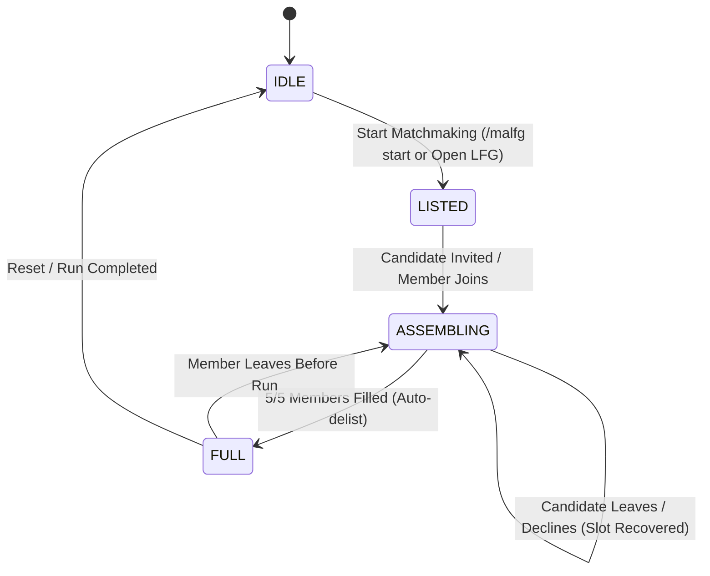

# MPlusAutoLFG

[](https://worldofwarcraft.blizzard.com)
[](https://www.lua.org)
[-green.svg)]()

**MPlusAutoLFG** is an automated, fair matchmaking assistant engineered for a **"Solo Queue"** style of play in Mythic+. Instead of arbitrary manual gatekeeping, the addon simulates an automatic dungeon finder queue: it selects the first eligible applicant in queue based on strict, deterministic mechanical rules.

---

## Key Highlights & Architectural Principles

- **Zero External Dependencies**: 100% native World of Warcraft Lua & XML APIs (clean modern slate canvas, native Blizzard indicator textures, native options menu). No Ace3, LibDataBroker, or LibDBIcon overhead.
- **Blizzard Protected API Compliance**: Calling `C_LFGList.InviteApplicant(applicantID)` requires an explicit hardware event. The addon implements a dedicated on-screen `SecureActionButtonTemplate` button labeled **"Invite"** (strictly mouse-click driven, no spacebar or keybind exploits).
- **Modern Blizzlike Dragonflight / TWW UI**: 
  - Unboxed 5-role party layout (`[Tank] [Healer] [DPS] [DPS] [DPS]`), full brightness when present, desaturated when missing.
  - Minimalist utilities: clean colored text for Bloodlust (`BL`) and Combat Res (`CR`).
  - Native Blizzard round indicator textures (`Interface\Common\Indicator-Green`, `Indicator-Yellow`, `Indicator-Gray`) replacing font-dependent Unicode characters.
  - Active listing auto-sync: automatically detects active Premade Groups listings, attaches to them, and starts the timer.
  - Party leader & listing mismatch safety guards: automatically disables controls and alerts the player if they are not the party leader or if the listed keystone differs from their bag keystone.
- **Rules Modes & AddOn Options Menu**:
  - Integrated into Blizzard's native Settings panel (`Game Menu -> Options -> AddOns -> MPlusAutoLFG` or `/malfg config`).
  - **Default Mode**: Tiered progression rules (+2-+6 open to all, +7-+11 [key - 2], +12+ [key - 1]).
  - **Custom Mode**: User-configurable sliders for key drop tolerance [Key - X] (0–5, default 2), ilvl deficit (0–30), timed runs requirement, and leader ilvl match.
- **Declarative Validation Pipeline (Chain of Responsibility)**: Isolated, pure validator rules in `Validation.lua` (`CheckRoleSlot`, `CheckItemLevel`, `CheckExperience`, `CheckDuplicates`, `CheckUtilities`).
- **Data Access Layer & Adapter Pattern**: `LFGService.lua` abstracts Blizzard's `C_LFGList`, `C_MythicPlus`, and `C_ChallengeMode` APIs, enabling clean runtime mocking and dependency injection.
- **Leaver / Decline Resilience**: Real-time tracking of `LFG_LIST_APPLICANT_UPDATED` and `GROUP_ROSTER_UPDATE`. If an invited or joined candidate declines or leaves before the dungeon starts, their reserved slot and utility flags (BL/CR) unlock immediately, resuming automated queue evaluation.

---

## Matchmaking Rules & Candidate Validation

Applicants are evaluated strictly in queue order (by ascending queue entry time / `applicantID`):

### 1. Group Roles & Target Composition
- Target team: **1 Tank, 1 Healer, 3 DPS**.
- Applicants whose role is already filled or currently reserved by an invited candidate are skipped.

### 2. Item Level Evaluation
- In **Default Mode**: Calculated dynamically from the party leader's equipped average item level:
  - **Key Level $\ge$ 18**: Leader ilvl $- 5$
  - **Key Level 15 to 17**: Leader ilvl $- 10$
  - **Key Level 12 to 14**: Leader ilvl $- 15$
  - **Key Level $<$ 12**: Leader ilvl $- 35$
- In **Custom Mode**: Enforces allowed deficit slider (0 to 30 ilvl below leader) and optional leader ilvl requirement.

### 3. Dungeon Experience Threshold
Evaluates applicant's best run on the exact dungeon of the active keystone:
- In **Default Mode**:
  - **Target Key Level 2 to 6**: Open to all applicants (+2 minimum key required).
  - **Target Key Level 7 to 11**: Must have completed the exact same dungeon at $\ge (\text{Target Key} - 2)$ within timer.
  - **Target Key Level $\ge$ 12**: Must have completed the exact same dungeon at $\ge (\text{Target Key} - 1)$ within timer.
- In **Custom Mode**:
  - Configurable key drop tolerance slider $[ \text{Key} - X ]$ (clamped to minimum +2).
  - Configurable checkbox: Require Timed Run (ignore overtime completions).

### 4. Class & Spec Duplicate Restrictions
- **Target Key Level $<$ 15**: Duplicate classes are permitted provided their specializations differ. Duplicate specializations are rejected.
- **Target Key Level $\ge$ 15**: Duplicate classes are strictly prohibited across the entire group.

### 5. Utility Requirements (Bloodlust & Combat Resurrection)
- **Mandatory Requirements**: At least 1 Bloodlust / Heroism provider and at least 1 Combat Resurrection provider per group.
  - **BL Classes**: Mage, Shaman, Hunter, Evoker.
  - **CR Classes**: Death Knight, Druid, Warlock, Paladin.
- **Dynamic Lock Rule**: If the number of remaining open slots equals the number of missing mandatory utilities (e.g., 1 slot left and group has no BL), all applicants unable to satisfy the missing utility are rejected.

---

## Finite State Machine (FSM)



- **`IDLE`**: Matchmaking inactive.
- **`LISTED`**: Premade group listed in LFG, 0 pending invites, scanning applicants.
- **`ASSEMBLING`**: 1–4 members or pending invites; actively evaluating and inviting candidates.
- **`FULL`**: 5/5 members. Internal stopwatch stops, group automatically delists from LFG, and formation stats are logged.

---

## File Structure

```
MPlusAutoLFG/
├── MPlusAutoLFG.toc         # TOC file with Midnight/Retail interface version & SavedVariables
├── Constants.lua            # Utility tables, class IDs, spec IDs, and role definitions
├── Services/
│   └── LFGService.lua       # Data Access Layer / Blizzard API adapter & active listing reader
├── Validation.lua           # Declarative Validation Pipeline (Default tiered & Custom modes)
├── Settings.lua             # Native Blizzard Settings Panel (Sliders, Checkboxes, Options)
├── UI.lua                   # Modern Dragonflight/TWW UI HUD, unboxed party slots, minimap & LFG button
├── Core.lua                 # FSM orchestrator, active listing sync, leader guards & slash commands
└── README.md                # Project documentation
```

---

## Slash Commands & Controls

| Command | Description |
| :--- | :--- |
| `/malfg` | Toggle main floating HUD window |
| `/malfg config` | Open AddOn Settings panel in Blizzard Game Options |
| `/malfg mode` | Toggle Rules Mode (`Default` vs `Custom`) |
| `/malfg start` | Read active keystone, calculate dynamic ilvl, and create automated LFG listing |
| `/malfg debug` | Toggle verbose applicant evaluation chat logs |
| `/malfg reset` | Reset queue state, pending invites, and restore frame positions |

---

## Installation & Live Usage

1. Copy the `MPlusAutoLFG` folder to:
   `World of Warcraft\_retail_\Interface\AddOns\MPlusAutoLFG\`
2. Launch or reload World of Warcraft (`/reload`).
3. Type `/malfg` in chat or click the Minimap button to toggle the HUD.
4. If your group is already listed in Premade Groups, `MPlusAutoLFG` automatically detects it and displays the active keystone, dungeon name, and queue status.
5. Click the prominent Blizzard-native **"Invite"** button to invite the top qualified applicant.
