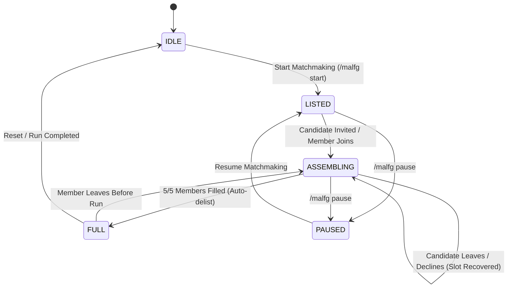

# MPlusAutoLFG

[](https://worldofwarcraft.blizzard.com)
[](https://www.lua.org)
[-green.svg)]()

**MPlusAutoLFG** is an automated, fair matchmaking assistant engineered for a **"Solo Queue"** style of play in Mythic+. Instead of arbitrary manual cherry-picking and gatekeeping, the addon simulates an automatic dungeon finder queue: it invites the first eligible applicant (**FIFO**) based on strict, deterministic mechanical rules.

---

## Key Highlights & Architectural Principles

- **Zero External Dependencies**: 100% native World of Warcraft Lua & XML APIs (`BackdropTemplate`, `NineSlice`, native event handlers, native minimap button). No Ace3, LibDataBroker, or LibDBIcon overhead.
- **Blizzard Protected API Compliance**: Calling `C_LFGList.InviteApplicant(applicantID)` requires an explicit hardware event. The addon implements a dedicated on-screen `SecureActionButtonTemplate` button labeled **"CLICK TO INVITE"** (strictly mouse-click driven, no spacebar or keybind exploits).
- **Declarative Validation Pipeline (Chain of Responsibility)**: Isolated, pure validator rules in `Validation.lua` (`CheckRoleSlot`, `CheckItemLevel`, `CheckExperience`, `CheckDuplicates`, `CheckUtilities`).
- **Data Access Layer & Adapter Pattern**: `LFGService.lua` abstracts Blizzard's `C_LFGList`, `C_MythicPlus`, and `C_ChallengeMode` APIs, enabling clean runtime mocking and dependency injection.
- **Leaver / Decline Resilience**: Real-time tracking of `LFG_LIST_APPLICANT_UPDATED` and `GROUP_ROSTER_UPDATE`. If an invited or joined candidate declines or leaves before the dungeon starts, their reserved slot and utility flags (BL/CR) unlock immediately, resuming automated FIFO evaluation.
- **Offline Simulation & Dev Harness**: Built-in `MockEngine.lua` with 7 realistic test fixtures to test all edge cases without live applicants.

---

## Matchmaking Rules & Candidate Validation

Applicants are evaluated strictly in **FIFO order** (by ascending queue entry time / `applicantID`):

### 1. Group Roles & Target Composition
- Target team: **1 Tank, 1 Healer, 3 DPS**.
- Applicants whose role is already filled or currently reserved by an invited candidate are skipped.

### 2. Dynamic Item Level Gatekeeper
Calculated dynamically from the party leader's equipped average item level (`GetAverageItemLevel()`):
- **Key Level $\ge$ 18**: Leader ilvl $- 5$
- **Key Level 15 to 17**: Leader ilvl $- 10$
- **Key Level 12 to 14**: Leader ilvl $- 15$
- **Key Level $<$ 12**: Leader ilvl $- 35$

Passed directly to native listing creation (`requiredItemLevel`) and verified in Lua as a double-check.

### 3. Dungeon Experience Threshold
Evaluates applicant's best run on the exact dungeon of the active keystone:
- **Target Key Level $\le$ 15**: Must have completed the exact same dungeon at $\ge (\text{Target Key} - 2)$ **within timer**.
- **Target Key Level $>$ 15**: Must have completed the exact same dungeon at $\ge (\text{Target Key} - 1)$ **within timer**.
- **Keys $\ge$ Target Key Level**: Strictly valid (retries, score upgrades, farm).

### 4. Class & Spec Duplicate Restrictions
- **Target Key Level $<$ 15**: Duplicate classes are permitted provided their specializations differ. Duplicate specializations are rejected.
- **Target Key Level $\ge$ 15**: Duplicate classes are strictly prohibited across the entire group.

### 5. Utility Requirements (Bloodlust & Combat Resurrection)
- **Mandatory Requirements**: At least 1 Bloodlust / Heroism provider and at least 1 Combat Resurrection provider per group.
  - **BL Classes**: Mage, Shaman, Hunter, Evoker.
  - **CR Classes**: Death Knight, Druid, Warlock, Paladin.
- **Dynamic Lock Rule**: If the number of remaining open slots equals the number of missing mandatory utilities (e.g., 1 slot left and group has no BL), all applicants unable to satisfy the missing utility are rejected.

---

## Finite State Machine (FSM)



- **`IDLE`**: Matchmaking inactive.
- **`LISTED`**: Premade group listed in LFG, 0 pending invites, scanning applicants.
- **`ASSEMBLING`**: 1–4 members or pending invites; actively evaluating and inviting candidates.
- **`FULL`**: 5/5 members. Internal stopwatch stops, group automatically delists from LFG, and formation stats are logged.
- **`PAUSED`**: Matchmaking paused by leader.

---

## File Structure

```
MPlusAutoLFG/
├── MPlusAutoLFG.toc         # TOC file with Midnight/Retail interface version & SavedVariables
├── MPlus Auto LFG.toc       # Compatibility TOC for space-delimited folder naming
├── Constants.lua            # Utility tables, class IDs, spec IDs, and role definitions
├── Services/
│   └── LFGService.lua       # Data Access Layer / Blizzard API adapter & mock delegate
├── Validation.lua           # Declarative Validation Pipeline (Chain of Responsibility)
├── MockEngine.lua           # Synthetic queue generator & realistic test fixtures
├── UI.lua                   # Native floating HUD, party badges, showcase card & secure button
├── Core.lua                 # FSM orchestrator, event bus, roster tracking & slash commands
└── README.md                # Project documentation
```

---

## Slash Commands & Developer Controls

| Command | Description |
| :--- | :--- |
| `/malfg` | Toggle main floating HUD window |
| `/malfg start` | Read active keystone, calculate dynamic ilvl, and create automated LFG listing |
| `/malfg pause` | Pause or resume automated queue evaluation |
| `/malfg debug` | Toggle Debug Mode & activate internal MockEngine |
| `/malfg sim` | Ingest 7 realistic synthetic applicants into the queue |
| `/malfg sim leaver` | Simulate an invited candidate declining/leaving to test slot recovery |
| `/malfg reset` | Wipe mock data, reset pending invites, and restore frame positions |

---

## Test Fixtures Included in `MockEngine`

1. **`Valeera`** (Subtlety Rogue, ilvl 636, Score 2850, +16 Timed): High-score DPS missing BL/CR; tests utility dynamic lock rejection.
2. **`Baine`** (Protection Warrior, ilvl 605, Score 2100, +14 Timed): Undergeared Tank; triggers dynamic ilvl threshold reject.
3. **`Anduin`** (Holy Priest, ilvl 630, Score 2250, +12 Timed): Low-experience Healer; triggers experience ($N-2$) threshold reject.
4. **`Jaina`** (Frost Mage, ilvl 633, Score 2680, +15 Timed): Valid Mage offering BL with verified dungeon experience; passes validation.
5. **`Khadgar`** (Frost Mage, ilvl 640, Score 2920, +17 Timed): Duplicate spec collision; tests spec/class exclusivity.
6. **`Bolvar`** (Blood DK, ilvl 635, Score 2710, +15 Timed): Valid Tank with Combat Resurrection.
7. **`Malfurion`** (Resto Druid, ilvl 634, Score 2690, +15 Timed): Valid Healer with Combat Resurrection.

---

## Installation

1. Copy the `MPlusAutoLFG` folder to:
   `World of Warcraft\_retail_\Interface\AddOns\MPlusAutoLFG\`
2. Launch or reload World of Warcraft (`/reload`).
3. Type `/malfg` in chat to toggle the floating HUD.
4. Type `/malfg debug` followed by `/malfg sim` to test the synthetic FIFO queue offline.
